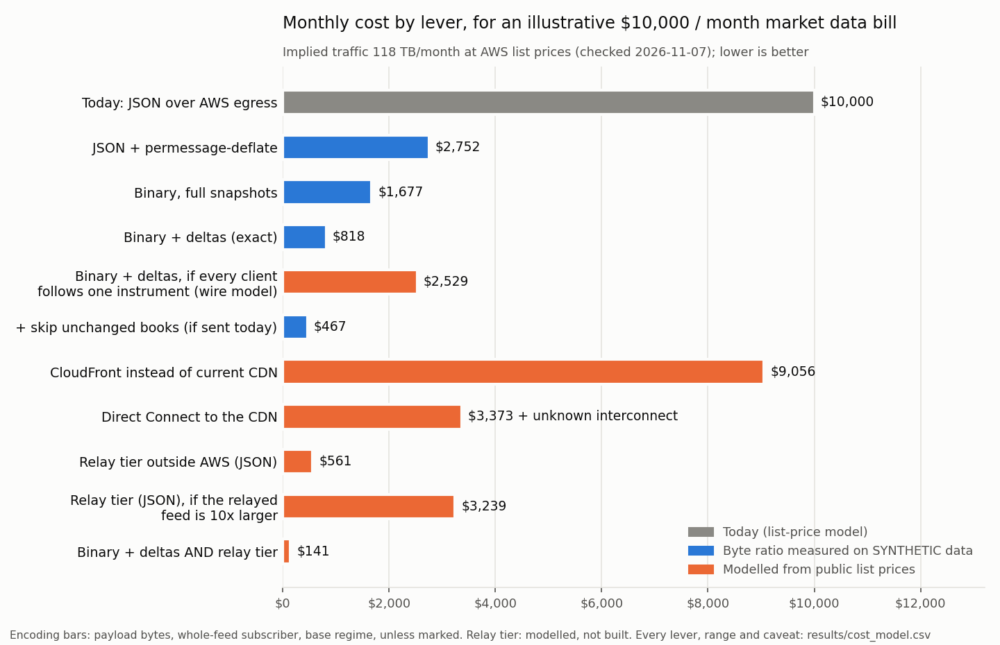

# binary-market-data

What actually lowers the bill for streaming exchange market data over WebSockets? I built a compact binary format in Rust with exact JSON round trips, then measured it against the baselines a senior engineer would ask about first. I also priced every lever from public list prices.

> **All market data here is synthetic.** The public API this models has a data usage policy that prohibits capturing its feed by automated means, including WebSocket capture, and prohibits publishing the result, so nothing was captured. `crates/synth` generates messages with the documented field shapes. Its market-activity parameters were committed before anything was measured (see [docs/synthetic-data.md](docs/synthetic-data.md)). Size ratios that depend on the format are fairly robust. Savings that depend on how often books change are only as good as those assumptions. `analyze` measures the assumed values from any real JSONL feed.



**What the chart says,** for an illustrative $10,000 a month bill (118 TB a month at AWS list prices):

- **For a whole-feed subscriber, binary with deltas cuts market data bytes by 93% on the synthetic feed** ($818 a month). Full binary snapshots alone cut 85%. Most of that comes from dropping JSON's text overhead; deltas then halve what remains.
- **Standard permessage-deflate is a strong baseline.** It cuts 75% with no new client code. Its cost is a compressor per connection: CPU and 376 KiB of memory each, and no encode-once fan-out (see the CPU tables).
- **The gap shrinks for small subscriptions.** If every client followed one instrument, per-packet TCP/TLS overhead would dominate, and in the wire model binary costs $2,529 against $3,170 for permessage-deflate.
- **Where the fan-out happens can matter as much as the encoding, in this model.** If AWS sends one copy of the feed to a few relays outside AWS instead of one per subscriber, today's JSON clients cost $561 at list price, and $141 with binary. That depends on how big the relayed feed is: at 10x the modelled feed, relaying JSON costs $3,239. The relay tier is modelled, not built.
- **Binary order requests barely move this bill.** AWS charges $0.00 per GB for inbound transfer. Order responses and private order and fill streams are outbound and billed, and were not measured here.

## The problem as a cost model

```
monthly bill  ~  subscribers x messages/s x bytes/message x $/GB
```

Each lever attacks one term:

- **Encoding:** bytes per message.
- **Deltas, skipping unchanged books, conflation:** messages and bytes.
- **Relay tier:** how many copies leave AWS.
- **Direct Connect and CloudFront:** $/GB.

Inbound traffic is free, so outbound traffic is the bill. For public subscribers that is mostly market data. [docs/cost-model.md](docs/cost-model.md) gives the formulas, list prices (checked 2026-11-07, as an upper bound) and assumptions.

## What is here

| Path | What it does |
|---|---|
| `crates/mdbin` | The format: exact fixed-point decimals (no floats), varint header with type, flags, instrument, per-stream sequence and timestamp, batching via `len`, book and ticker deltas, gap detection and snapshot recovery, EIP-712 signed orders with 65 raw signature bytes in place of hex. Spec: [docs/format-spec.md](docs/format-spec.md). Research: [docs/format-research.md](docs/format-research.md). |
| `crates/gateway` | An edge gateway prototype. A client offering `Sec-WebSocket-Protocol: mdbin.v1` gets binary; every other client keeps today's JSON. Each message is transcoded once, however many clients are connected. Orders are decoded, their signatures checked at the edge, and forwarded over ZMQ on TCP to a **mock** matching core. |
| `crates/synth` | The synthetic feed and signed orders (test key only). |
| `crates/bench` | `sizes`, `timing`, `fuzz`, `analyze`, `sample`, and Criterion benches. |
| `crates/broker` | Redis and Dragonfly: byte-exact binary `PUBLISH` and `SET`/`GET`, publish-to-receive latency, and throughput ceiling. |
| `costmodel/` | `cost_model.py` (uv, pinned) and `pricing.toml` with a source for every price. |
| `results/` | Everything below, regenerated by `make reproduce`. |

## Results

<!-- summary:start -->
### Bytes per second, whole-feed subscriber (SYNTHETIC data, base regime)

178 instruments, 600 ticks of 100 ms after a 50-tick warm-up. Ratio is payload bytes relative to JSON. Range is across the calm, base and busy regimes.

| Encoding | KB/s | vs JSON | Saving | Range across regimes | Wire, modelled |
|---|---:|---:|---:|---|---:|
| JSON as sent today | 659.3 | 1.000 | 0% | 1.000 to 1.000 | 1.000 |
| JSON + permessage-deflate, no context takeover | 423.3 | 0.642 | 36% | 0.641 to 0.642 | 0.709 |
| JSON + zstd with a trained dictionary | 182.4 | 0.277 | 72% | 0.262 to 0.279 | 0.408 |
| JSON + permessage-deflate, context takeover | 161.7 | 0.245 | 75% | 0.245 to 0.247 | 0.383 |
| Binary, full snapshots | 97.1 | 0.147 | 85% | 0.147 to 0.148 | 0.125 |
| Binary + deltas (exact round trip) | 46.2 | 0.070 | 93% | 0.062 to 0.087 | 0.059 |
| Binary + deltas, unchanged books skipped | 26.1 | 0.040 | 96% | 0.028 to 0.064 | 0.034 |
| ... and books conflated to 1 s | 20.0 | 0.030 | 97% | 0.026 to 0.035 | 0.026 |
| Binary + deltas + permessage-deflate | 22.5 | 0.034 | 97% | 0.026 to 0.050 | 0.029 |

- Unchanged books between consecutive 100 ms publishes (an assumption-driven SYNTHETIC output): calm 95%, base 85%, busy 63%.
- An SBE-style fixed-width layout (Binance `DepthSnapshotStreamEvent` shape) would be 0.498 of JSON for books; the varint layout here is 0.134.
- One-instrument subscribers, wire model: binary + deltas 0.225 of JSON, JSON + permessage-deflate 0.283. Small frames are dominated by TCP/TLS overhead, so the saving shrinks.
- Joining the whole binary feed costs 34.7 KB once per connection (directory and snapshots).
- Raw-JSON fallbacks across all runs: 0. Every synthetic message round-tripped exactly.
- Signed order requests: 491 bytes as JSON, 121 as binary; the signature goes from 134 characters of hex to 65 bytes. Requests are inbound, which AWS does not charge for; responses were not measured.

### CPU and memory (MEASURED on one machine, SYNTHETIC inputs)

Intel(R) Core(TM) i7-9700K CPU @ 3.60GHz, 8 cores, WSL2 kernel 6.18.54.1-microsoft-standard-WSL2, load average 1.15 2.00 2.53 at start. These are serialization and copy costs, not network latency.

| Per message | CPU ns |
|---|---:|
| Parse JSON into a generic value (what a JSON client pays) | 2,847 |
| Transcode JSON to binary + deltas (gateway, once per message) | 3,788 |
| Decode binary and apply to local state (client) | 270 |
| Decode, apply and rebuild the exact JSON text | 799 |
| permessage-deflate, per connection | 13,398 |
| zstd with dictionary, once per message | 1,914 |
| Verify one order signature (secp256k1 recover, pure Rust) | 175,487 |

| Fan-out, CPU per connection per second of feed | microseconds |
|---|---:|
| Binary: transcode once, copy shared bytes | 44.3 |
| JSON as is: copy shared bytes | 116.6 |
| permessage-deflate without context: compress once, copy | 375.6 |
| permessage-deflate with context: compress per connection | 25,512.4 |

Per-connection compressor state, live heap after traffic: 376 KiB for permessage-deflate with context. Binary encode-once keeps no per-connection codec state.

### Redis and Dragonfly pub/sub (MEASURED on loopback)

| Server | Byte-exact (7 hostile payloads, PUBLISH and SET/GET) | p50 / p99 publish-to-receive, 2000 msg/s, one subscriber | Pipelined ceiling, binary msgs/s, one subscriber |
|---|---|---|---:|
| Dragonfly v2.1 | yes, all | 171 / 860 us | 214,377 |
| Redis 7.0.15 | yes, all | 186 / 926 us | 676,172 |

The synthetic whole feed is 1,960 messages per second.

### Decoder mutation testing

2,000,000 seeded mutations (byte flips, truncation, junk insertion, random frames), each applied after a valid snapshot frame; not coverage-guided: 0 panics.

### Monthly cost by lever (MODEL)

List prices checked 2026-11-07 are an upper bound. Bills are illustrative. Encoding ratios are from the SYNTHETIC base regime.

| Lever | $1,000/month | $10,000/month | $30,000/month |
|---|---:|---:|---:|
| Implied traffic | 10 TB | 118 TB | 455 TB |
| Today: JSON over AWS egress | $1,000 | $10,000 | $30,000 |
| Binary, full snapshots | $154 | $1,677 | $6,045 |
| Binary + deltas (exact) | $77 | $818 | $3,028 |
| + skip unchanged books (if sent today) | $47 | $467 | $1,740 |
| + conflate books to 1 s (opt-in) | $38 | $359 | $1,348 |
| JSON + permessage-deflate | $251 | $2,752 | $9,515 |
| JSON + zstd dictionary | $282 | $3,097 | $10,627 |
| Binary + deltas, one-instrument subscribers (wire model) | $231 | $2,529 | $8,795 |
| JSON + permessage-deflate, one-instrument subscribers (wire model) | $289 | $3,170 | $10,860 |
| Direct Connect to the CDN | $504 + unknown | $3,373 + unknown | $13,776 + unknown |
| CloudFront instead of current CDN | $957 | $9,056 | $25,601 |
| Relay tier outside AWS (JSON) | $431 | $561 | $1,583 |
| Binary + deltas AND relay tier | $133 | $141 | $169 |
| Relay tier (JSON), feed 10x larger | $3,110 | $3,239 | $7,762 |
| Binary + deltas AND relay tier, feed 10x larger | $329 | $336 | $365 |
| Binary orders | $995 | $9,995 | $29,995 |
<!-- summary:end -->

## What the results say

1. **Most of the binary saving comes from dropping JSON's text overhead.** Keys, channel strings and decimal text go, and integer instrument IDs replace names, taking a whole-feed subscriber to 0.147 of JSON. Deltas then halve what remains, to 0.070. Skipping unchanged books goes further, but only if the venue publishes unchanged books today. The docs do not say, so that bar is conditional.
2. **The format is exact, and the transcoder checks it.** After parsing a message, the transcoder renders it back and compares the result with the input. Anything that would not come back byte for byte goes out as raw JSON instead of being reshaped: an unknown field, a number where a string was documented, a non-canonical decimal, different whitespace or key order. Binary clients then rebuild the JSON stream exactly, which is checked over real sockets in `crates/gateway/tests/e2e.rs` and by property tests. One caveat: the synthetic generator writes the schema's key order, so 0 fallbacks here says nothing about a real feed. If a real feed used a different key order, every message would fall back, and the renderer would need that order before binary saved anything.
3. **permessage-deflate is the honest competitor.** It needs no new client, and for a whole-feed subscriber binary with deltas is about 3.5 times smaller. Its costs are per connection, and it cannot be encoded once and shared. Turning off context takeover makes it shareable, but loses most of the gain (0.642 of JSON).
   - The CPU figure was measured with `miniz_oxide` at level 6 with a 15-bit window. zlib-ng, a lower level or a smaller window would cost less. At the illustrative $10k bill, `results/cost_model.csv` puts it at about two cores.
   - A whole-feed tick is bigger than deflate's 32 KB window, so deflate rarely sees the same book's previous message. Clients following fewer instruments compress better.
   - Binary on top of permessage-deflate reaches 0.034, so the two are not exclusive.
   - The baseline not measured here is JSON deltas, which a venue could ship without a new format.
4. **Small subscriptions are limited by TCP/TLS overhead, not encoding.** In the wire model, a client following one instrument saves less (0.225 of JSON) than a whole-feed client, because per-packet headers dominate a delta of about 23 bytes. Batching per tick only helps when there is something to batch.
5. **Encoding order requests is not a cost lever.** Requests shrink from 491 to 121 bytes, but they flow inbound, which AWS does not charge for. Order responses and private order and fill streams flow outbound and are billed. They were not measured here, and they deserve the same treatment as market data. The reasons to encode requests are parsing cost and latency, not the bill.
6. **A Redis-compatible broker would not be the bottleneck.** If one sits between a matching engine and its gateways, binary can go straight through it.
   - Redis and Dragonfly both carried the binary format byte for byte through `PUBLISH` and `SET`/`GET`, including NUL bytes, CRLF and RESP lookalikes, and invalid UTF-8.
   - With one subscriber on loopback, their pipelined ceilings were more than a hundred times the synthetic feed's message rate, in every run.
   - Median publish-to-receive latency was the same for binary and JSON. The tails differ by run.
   - So I did not build a custom pub engine. Replacing a broker that also holds rate limits or caches would mean rebuilding those too, for no measured gain.
   - Not tested: many subscribers, or a real network.
7. **Checking signatures at the edge has a price.** On this machine, recovering a secp256k1 signer in pure Rust cost tens of times the CPU of transcoding one market data message (see the CPU table). That is fine for rejecting garbage early, and the gateway caps orders per frame so a client cannot queue unbounded work. At high order rates it is a capacity decision about where verification belongs, and it should run off the async workers.
8. **ZMQ PUB/SUB drops messages silently under load.** The e2e test saw it in a debug build. The binary stream stays correct anyway, because upstream books are full snapshots and the transcoder diffs against whatever it last received.

## How to run

Requires Rust 1.99.1 (pinned in `rust-toolchain.toml`), [uv](https://docs.astral.sh/uv/), and optionally `redis-server` and `dragonfly` on `PATH`. A missing broker is recorded as untested. Nothing touches the network.

```
make reproduce     # tests, sizes, sample, analyzer, fuzzing, brokers, timing, cost model, number check
make demo          # mock core + gateway + a JSON client and a binary client, side by side
make bench-criterion
```

Size and cost results are deterministic. Timing and broker results depend on the machine, so run them on a quiet one. `make reproduce` rewrites the Results block of this README from `results/`, then checks that every number quoted outside the block appears in the results.

## Limitations

- **The data is synthetic.** The cadence, the share of unchanged books, the level counts, the number of decimal digits and the message mix are assumptions ([docs/synthetic-data.md](docs/synthetic-data.md)). The delta and skip-unchanged savings move with them, as the regime ranges show.
- **The bills are illustrative.** Prices are public list prices, so they are an upper bound before discounts. The model assumes the whole bill is market data egress. The CDN interconnect price, CloudFront flat-rate eligibility for WebSockets, relay operating cost and added latency are unknown or not modelled.
- **Timing is from one machine.** It was measured under WSL2 on loopback: serialization and copy costs only, not network latency. The machine was shared with other jobs, and the per-message figures varied noticeably between runs, so read them as orders of magnitude. Nothing here says how fast a production system is.
- **The wire model is a model.** It assumes one WebSocket message per TCP segment, with no coalescing. That makes unbatched JSON look worse than it may be, which is why the encoding comparison and the chart use payload bytes.
- **The gateway is a prototype.**
  - There is no TLS, authentication or per-client rate limiting.
  - Resync requests are not rate-limited and take a shared lock.
  - Signature checks run on the async workers.
  - Acks are dropped if a client's ack queue is full.
  - The matching core is a mock that acknowledges every order.
  - Trigger, algo and fee-extension order params stay on the JSON path.
- **Order costs are only half measured.** Order requests are inbound and free. Order responses and private order and fill streams are billed outbound, and were not measured.
- **The relay tier is modelled, not built.** Its cost depends on how much of the feed a relay must carry, and on relay capacity, which is assumed. Private channels cannot be relayed this way.
- **The mutation testing is seeded, not coverage-guided.**
- **JSON key order** is assumed to follow the schema. The round trip is byte-exact for that order. A different real key order changes bytes, not values.

## What I would do next

1. Get permission to measure a real feed, or have the venue run `analyze` on its own data, and replace every assumption in the synthetic generator.
2. Run a relay on a non-AWS host near the matching region, and measure added latency and real egress over a week before trusting the relay-tier number.
3. Offer binary as opt-in to a few heavy subscribers first. Their traffic decides most of the bill, and they are the most likely to write a decoder.
4. Test permessage-deflate's real CPU cost in the production WebSocket stack, since it may beat a new format for clients that cannot change.
5. Merge type and flags into one header byte, and try field-level deltas for option greeks. The ticker is now the largest remaining share.

## AI use

Claude Code (Anthropic) wrote most of the code and documentation and ran the experiments, working from a plan I approved. A separate Claude reviewer then read the repo as a skeptical interviewer would, and its findings were fixed before release. I own the design decisions: making binary exact rather than lossy, measuring against compression, relay tier and broker baselines, falling back to synthetic data when the API terms ruled out capture, and choosing what to trust in the results. Items I still need to review by hand are tracked outside this repo, and this section will be updated when that review is done.

## Licence

MIT, see [LICENSE](LICENSE).
